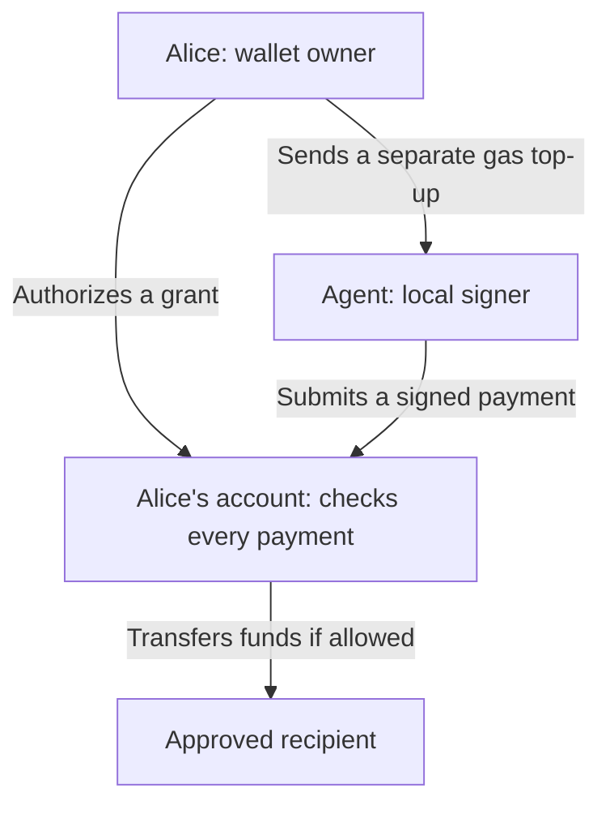

# Agent Wallet

Let a program spend from your wallet, within rules you approve.

- **Live demo:** [agentic.stable.xyz](https://agentic.stable.xyz).
- **Network:** Stable Testnet. Payments use test USDT0.
- **Status:** Proof of concept. Unaudited. No mainnet support.

## Start with the people and the money

- **Alice** owns the wallet and approves permissions.
- **The agent** is software that acts for Alice. Here, it is a local payment script; no AI model is included.
- **A signing key** is a secret used to authorize transactions. A **signature** lets the network verify the signer.
- **A smart contract** is code the blockchain runs. This contract checks each payment before moving Alice's funds.

Alice gives the agent a **grant**: permission to pay one recipient, up to a total amount, before a deadline.

The agent uses its own key. Alice authorizes the grant once; the contract checks each payment.



## One grant, three attempts

Alice authorizes a total budget of **0.01 USDT0** for one recipient.

| Attempt | Result | Budget left |
| --- | --- | --- |
| Pay `0.006` | Succeeds | `0.004` |
| Pay another `0.006` | Blocked: exceeds the remaining budget | `0.004` |
| Pay `0.004` | Succeeds | `0` |

- The budget covers successful payments together. It does not reset after each payment.
- The contract also checks the signer, recipient, deadline, grant status, and payment ID.
- A payment ID labels one intended payment. After success, it cannot be used again under any grant on Alice's account.
- A blocked payment leaves Alice's funds and recorded spending unchanged. An included transaction that fails can still cost gas.

Grants do not reserve funds. Alice must keep enough money available. Two `0.01` grants can permit `0.02` in total.

## Who pays gas?

**Gas** is the network fee for executing a transaction.

- Alice pays to enable her account, create or revoke grants, and send gas funding.
- The agent pays the gas for its payments. The payment amount comes from Alice.
- The app shows the agent's balance and an estimated gas reserve. Alice can click **Fund agent gas** for a separate MetaMask transfer.
- That top-up is outside the grant budget. The agent controls it; revoking a grant does not return it.

## Why Alice keeps her address

[EIP-7702](https://eips.ethereum.org/EIPS/eip-7702) lets an existing account execute contract code. Alice enables the wallet code once through a local script. Her address and funds stay in place.

- EIP-7702 enables the code. This contract supplies the spending limits.
- Delegation persists after grant expiry. Revoking a grant does not remove the wallet code.
- Alice's owner key still controls the account and can replace the delegation. These limits constrain the agent, not Alice.

See the [wallet guide](agent-wallet/README.md#how-transactions-reach-alices-account) for the exact MetaMask and payment paths.

## Use the demo or run your own

- The [hosted demo](https://agentic.stable.xyz) displays one configured Alice account. You can inspect its grants. Only Alice can manage them.
- For your own account, follow the [setup guide](agent-wallet/README.md#1-set-up-alice-and-the-agent). You need Node.js 22+, Foundry, Chrome MetaMask, and test USDT0.
- Keys stay local. Git ignores Alice's key file and the agent's keystore; see [setup](agent-wallet/README.md#1-set-up-alice-and-the-agent).
- The browser uses MetaMask. Cloudflare serves the UI and public configuration; it does not run the agent or sign payments.

Already set up? From the repository root:

```sh
npm ci
npm run dev
```

Open [localhost:5174](http://localhost:5174) in Chrome. Retain your keys and transaction records.

## Find the next step

- [Set up, authorize, fund, and pay](agent-wallet/README.md#1-set-up-alice-and-the-agent).
- [Recover a payment after a timeout](agent-wallet/README.md#4-recover-without-paying-twice).
- [Run local checks and live acceptance](agent-wallet/README.md#checks).
- [Deploy to Cloudflare](agent-wallet/README.md#deploy).
- [Read the contract](agent-wallet/contracts/AgentWallet.sol), [shared client](agent-wallet/client/client.ts), or [UI](agent-wallet/app/src/App.tsx).

This demo proves bounded transfers. It does not provide merchant delivery, gas sponsorship, an AI decision system, or production custody.
