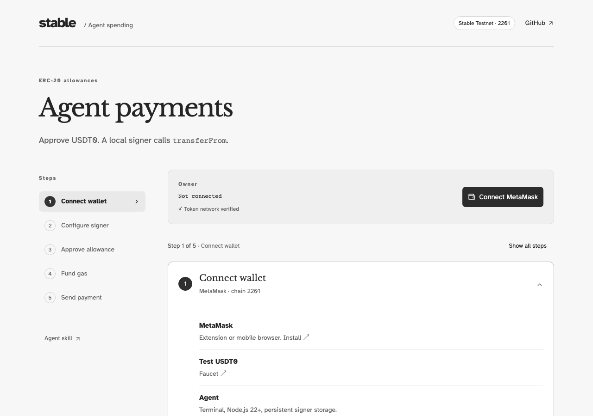

# Agent payments on Stable Testnet

USDT0 allowances and ERC-20 `transferFrom` payments. The owner approves spending in MetaMask; a local agent signer submits payments.

[Demo](https://agentic.stable.xyz) · [Agent skill](skills/agent-wallet-cli/SKILL.md) · [CLI reference](docs/cli.md) · [Release evidence](https://github.com/stablelabs/agentic.stable.xyz/releases/tag/cli-v0.2.1)



## Demo

Requires MetaMask, [test USDT0](https://faucet.stable.xyz), and an agent with terminal access, Node.js 22+ and persistent signer storage. Network: Stable Testnet, chain `2201`.

1. Connect MetaMask.
2. Paste the setup prompt into your agent chat. Open its approval link in the same browser.
3. Approve an allowance, e.g. `0.01` USDT0.
4. Fund the signer with native USDT0 for gas.
5. Set recipient and amount. Paste the payment prompt into the same chat; verify the confirmed receipt.

Allowances permit any recipient and have no expiry. Approval reserves no funds. Revocation takes effect on confirmation and does not reclaim gas funding. To change a nonzero allowance, revoke first.

## CLI

For an existing signer, use its original absolute state directory.

```sh
npm install --global @stablechain/agent-wallet-cli@0.2.1
export WALLET_STATE_DIR="$HOME/.agent-wallet-erc20"
agent-wallet init --json
agent-wallet config import --file /absolute/path/wallet-config.json --json
agent-wallet allowance link --amount 0.01 --json
```

Download `wallet-config.json` in step 2. Initialization, config import and approval-link generation are local.

After approval and gas funding:

```sh
agent-wallet payments prepare --recipient RECIPIENT_ADDRESS --amount 0.006 --json
PAYMENT_ID="value of data.paymentId"
agent-wallet pay --payment-id "$PAYMENT_ID" --json
```

`pay` checks balance, allowance and gas before signing. Add `--dry-run` to simulate. Confirm completion with `status: confirmed` and the receipt. For uncertain results, use `payments show`, `payments wait` or `payments resume` with the original ID and signer directory. A new ID can pay twice.

<a id="run-the-demo"></a>

## Development

Node.js 22.12+ and npm. Replace `OWNER_ADDRESS` and `AGENT_ADDRESS` with your MetaMask account and initialized signer:

```sh
npm ci
export WALLET_STATE_DIR="$PWD/.agent-wallet-erc20"
npm run wallet -- init --json
npm run wallet:configure -- --owner OWNER_ADDRESS --agent AGENT_ADDRESS
npm run wallet -- config import --file web/public/wallet-config.json --json
npm run dev
```

Open [localhost:5174](http://localhost:5174). For another port, set `--approval-url` during configuration. Run source CLI commands with `npm --silent run wallet --`.

React/Vite, shadcn/ui and Radix. Self-hosted Libre Baskerville headings and Atkinson Hyperlegible body text. Cloudflare serves static assets and public settings; signers run locally.

## Verification

```sh
npm run check
npm test
npx playwright install chromium
npm run test:browser
npm run build
npm run pack:cli
```

Blockchain tests use fixtures. [CI](.github/workflows/deploy.yml) verifies PRs; `main` also checks the published CLI/skill, deploys and smoke-tests the site. See the [release checklist](docs/release.md) for publication and live acceptance.

Testnet only; unaudited. Signer keys are plaintext files with restricted permissions. See the [operating guide](docs/wallet.md) for configuration, recovery and migration from 0.1.x.
