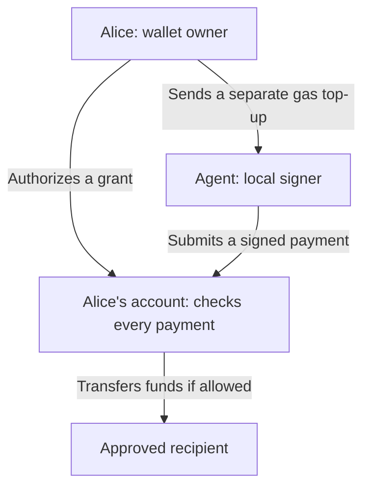

# Agent Wallet

Let a program spend from your wallet, within rules you approve.

- **Live demo:** [agentic.stable.xyz](https://agentic.stable.xyz).
- **Network:** Stable Testnet. Payments use test USDT0.
- **Status:** Proof of concept. Unaudited. No mainnet support.

## Install the CLI or SDK

With Node.js 22 or newer, run the published CLI without cloning the repository:

```sh
npx --yes --package=@stablechain/agent-wallet-cli@0.1.1 agent-wallet --help
```

For a persistent installation, use `npm install --global @stablechain/agent-wallet-cli@0.1.1`. Follow the [CLI guide](docs/cli.md) to create an agent signer, import public account settings, obtain Alice's approval, and submit payments. Keep the agent's state directory across runs.

Applications can install the owner SDK separately:

```sh
npm install @stablechain/agent-wallet-sdk@0.1.1 viem
```

See the [SDK guide](docs/sdk.md) for owner operations and recovery. The published CLI and SDK do not require the repository's Foundry or web build tools.

## Start with the people and the money

- **Alice** owns the wallet and approves permissions.
- **The agent** is software that acts for Alice. Here, it uses the local CLI signer; no AI model is included.
- **A signing key** is a secret used to authorize transactions. A **signature** lets the network verify the signer.
- **A smart contract** is code the blockchain runs. This contract checks each payment before moving Alice's funds.

Alice gives the agent a **grant**: permission to pay one recipient, up to a total amount, before a deadline.

The agent uses its own key. Alice authorizes the grant once; the contract checks each payment.



## One grant, three attempts

Alice authorizes a total budget of **0.01 USDT0** for one recipient.

| Attempt | Result | Budget left |
| --- | --- | --- |
| Pay `0.006` | Succeeds | `0.004` |
| Pay another `0.006` | Blocked: exceeds the remaining budget | `0.004` |
| Pay `0.004` | Succeeds | `0` |

- The budget covers successful payments together. It does not reset after each payment.
- The contract also checks the signer, recipient, deadline, grant status, and payment ID.
- A payment ID labels one intended payment. After success, it cannot be used again under any grant on Alice's account.
- A blocked payment leaves Alice's funds and recorded spending unchanged. An included transaction that fails can still cost gas.

Grants do not reserve funds. Alice must keep enough money available. Two `0.01` grants can permit `0.02` in total.

## Who pays gas?

**Gas** is the network fee for executing a transaction.

- Alice pays to enable her account, create or revoke grants, and send gas funding.
- The agent pays the gas for its payments. The payment amount comes from Alice.
- The app shows the agent's balance and an estimated gas reserve. Alice can click **Fund agent gas** for a separate MetaMask transfer.
- That top-up is outside the grant budget. The agent controls it; revoking a grant does not return it.

## Why Alice keeps her address

[EIP-7702](https://eips.ethereum.org/EIPS/eip-7702) lets an existing account execute contract code. Alice enables the wallet code once through a local script. Her address and funds stay in place.

- EIP-7702 enables the code. This contract supplies the spending limits.
- Delegation persists after grant expiry. Revoking a grant does not remove the wallet code.
- Alice's owner key still controls the account and can replace the delegation. These limits constrain the agent, not Alice.

See the [wallet guide](docs/wallet.md#how-transactions-reach-alices-account) for the exact MetaMask and payment paths.

## Repository packages

The repository is an npm workspace with four separate packages:

| Package | Directory | Responsibility |
| --- | --- | --- |
| `agent-wallet-web` | [packages/web](packages/web) | React UI that imports owner operations from `@stablechain/agent-wallet-sdk`. |
| `@stablechain/agent-wallet-cli` | [packages/cli](packages/cli) | Agent executable and private local state; depends on the SDK protocol entry. |
| `@stablechain/agent-wallet-sdk` | [packages/sdk](packages/sdk) | Owner API and shared browser-compatible wallet protocol. |
| `agent-wallet-contracts` | [packages/contracts](packages/contracts) | Solidity implementation, Foundry tests, migration fixtures, and compiled artifacts. |

Each package owns its source, manifest, build, checks, and tests. Root `scripts/` contains operator tools and compatibility adapters, `tests/` contains integration and packaging checks, and `docs/` contains guides. The root package orchestrates the workspaces.

Run development commands from the repository root with Node.js 22+ and npm. Full checks and contract builds require [Foundry](https://getfoundry.sh/introduction/installation); use version 1.5.1 to match release CI. Browser tests also need Playwright's Chromium:

```sh
npm ci
npx playwright install chromium
npm run build          # SDK, CLI, web app, and contracts; requires Foundry
npm run build:cloudflare # Web deployment build; no Foundry required
npm run dev            # Build SDK and start the web app
npm run wallet -- --help
npm run check
npm test
npm run test:contracts
npm run test:browser
```

To work on one package, use `npm run build --workspace PACKAGE`, replacing `PACKAGE` with a name from the table. Build the SDK before its consumers. `npm run build:tools` builds the SDK and CLI; `npm run dev:sdk` watches the SDK in a second terminal during development. See [checks](docs/wallet.md#checks) for test prerequisites and a fresh-cache packaging check.

Pushes to `main` deploy the web app. Matching stable version tags publish the SDK and CLI through npm trusted publishing after checks pass. Manual release workflow runs perform dry runs. See the [release guide](docs/releases.md) before preparing a version.

## Use the demo or run your own

- The [hosted demo](https://agentic.stable.xyz) displays one configured Alice account. You can inspect its grants. Only Alice can manage them.
- For your own account, follow the [setup guide](docs/wallet.md#1-set-up-alice-and-the-agent). You need Node.js 22+, Foundry, Chrome MetaMask, and test USDT0.
- Keys stay local. Git ignores Alice's key file and the agent's state directory; see [setup](docs/wallet.md#1-set-up-alice-and-the-agent).
- The browser uses MetaMask. Cloudflare serves the UI and public configuration; it does not run the agent or sign payments.

Already set up? From the repository root:

```sh
npm ci
npm run dev
```

Open [localhost:5174](http://localhost:5174) in Chrome. Retain your keys and transaction records.

## Find the next step

- [Use the agent CLI](docs/cli.md) or [integrate the owner SDK](docs/sdk.md).
- [Set up, authorize, fund, and pay](docs/wallet.md#1-set-up-alice-and-the-agent).
- [Recover a payment after a timeout](docs/wallet.md#4-recover-without-paying-twice).
- [Run local checks and live acceptance](docs/wallet.md#checks).
- [Deploy to Cloudflare](docs/wallet.md#deploy).
- [Release the CLI and SDK to npm](docs/releases.md).
- [Read the implemented CLI and SDK design](docs/cli-plan.md).
- [Read the contract](packages/contracts/src/AgentWallet.sol), [shared client](packages/sdk/src/client/client.ts), or [UI](packages/web/src/App.tsx).

This demo proves bounded transfers. It does not provide merchant delivery, gas sponsorship, an AI decision system, or production custody.
