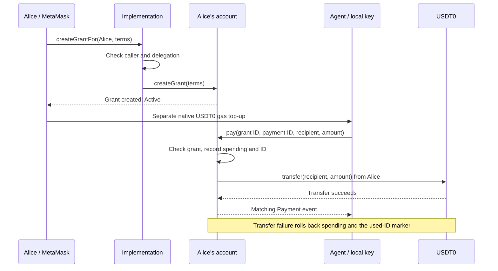
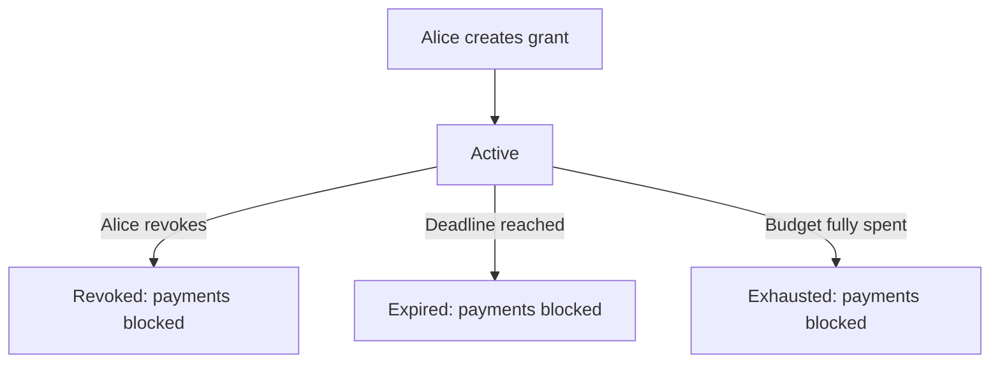

# Wallet guide

[Start with the overview](../README.md) for grants, gas, and the spending example. This guide covers operating the demo.

## 1. Set up Alice and the agent

- Use Node.js 22+, [Foundry](https://getfoundry.sh/introduction/installation), and Chrome MetaMask. Solidity is pinned to `0.8.30`.
- Choose a fresh test-only Alice account. Use the same address in MetaMask and the local setup script.
- Fund Alice with test USDT0 before enabling her account. Deployment and activation cost gas. See the [Stable faucet](https://faucet.stable.xyz).
- Run these commands from the repository root:

```sh
npm ci
umask 077
cp -n agent-wallet/.env.alice.example agent-wallet/.env.alice.local
chmod 600 agent-wallet/.env.alice.local
```

- Set `ALICE_PRIVATE_KEY` in `agent-wallet/.env.alice.local`: `0x` followed by 64 hexadecimal characters. Use a test-only key.
- Only `wallet:enable` reads this file. Never enter a private key in the web app.
- The example file also sets the testnet RPC and local approval-page URL.

```sh
npm run contracts
npm run wallet:enable
npm run wallet:init-agent
npm run dev
```

- `wallet:enable` deploys the implementation and authorizes it at Alice's existing address through EIP-7702. It verifies the installed code.
- `wallet:init-agent` generates a separate key and prints its address. Repeating it retains the existing key.
- Open [localhost:5174](http://localhost:5174) in Chrome. Connect Alice in MetaMask.

**Retain local state:** `.agent-wallet/` contains the agent's plaintext key, configuration, and transaction journals. File permissions restrict access: `700` for the directory, `600` for private files. This is not encrypted storage. Do not delete it to fix an error.

## 2. Authorize a grant, then fund gas

Enter these terms in the app:

| Field | Example | Meaning |
| --- | --- | --- |
| Agent signer | Address from `wallet:init-agent` | Key allowed to submit payments |
| Allowed recipient | Your test recipient's address | Only destination for this grant |
| Cumulative budget | `0.01` USDT0 | Total allowed across successful payments |
| Expires | A future UTC time | Payments must execute before this deadline |

- Click **Create and authorize grant**. Review and confirm in MetaMask.
- One transaction creates an **Active** grant. Save its grant ID.
- Check **Agent gas** below the grant. If needed, review the amount and click **Fund agent gas**. Confirm this separate transfer in MetaMask.
- Alice pays both transaction fees. Gas funding belongs to the agent and does not reduce the grant's recorded budget.

The gas reserve estimates one payment, adds 50% extra gas, and uses twice the current base fee. The suggested top-up targets three payments. Costs can change; a failed check shows an unavailable status.

To prefill a grant without submitting a transaction:

```sh
expires=$(node -p 'new Date(Date.now() + 86400000).toISOString().replace(/\.\d{3}Z$/, "Z")')
npm run wallet:grant-link -- \
  --recipient 0xRECIPIENT_ADDRESS \
  --budget 0.01 \
  --expires "$expires"
```

Replace the recipient placeholder. The agent defaults to the initialized signer; `--agent 0xAGENT_ADDRESS` overrides it. Alice still reviews and authorizes the terms. `wallet:request` is retired.

## 3. Pay from the agent

Use the confirmed grant ID and its exact recipient:

```sh
npm run wallet:pay -- \
  --grant 0xGRANT_ID \
  --recipient 0xRECIPIENT_ADDRESS \
  --amount 0.006
```

- The script saves a payment ID before submission, then signs locally with the agent's key.
- The agent pays gas. Alice supplies the `0.006` payment.
- Under a `0.01` grant, another `0.006` is blocked. A new `0.004` payment can use the remainder.
- Amounts accept at most six decimal places. Extra digits are rejected, not rounded.

Stable exposes USDT0 as a native gas balance with 18 decimals and an ERC-20 balance with six decimals. These represent the same underlying funds. Do not add them together.

## 4. Recover without paying twice

A timeout means the outcome is unknown. It does not prove failure.

- Check the transaction hash first.
- Retry with the printed payment ID and identical terms:

```sh
npm run wallet:pay -- \
  --grant 0xGRANT_ID \
  --recipient 0xRECIPIENT_ADDRESS \
  --amount 0.006 \
  --payment-id 0xSAVED_PAYMENT_ID
```

- The journal retains the intent, signed transaction, hash, and nonce before broadcast. Retries reuse signed bytes or report the existing confirmation.
- Omitting `--payment-id` creates a new intent. Do not do that to recover an unknown payment.
- A successful receipt must contain the matching `Payment` event. A cancellation or replacement with a different action is not confirmation.
- Rejection before submission costs no gas. An included revert can cost gas, but rolls back the payment, spending, and used-ID marker.

The UI also retains submitted grant and gas-funding hashes across reloads. Unknown funding outcomes block another top-up until **Check funding confirmation** resolves the saved transaction.

## How transactions reach Alice's account

The **implementation** supplies Alice's wallet code. EIP-7702 makes it execute with Alice's address, funds, and storage.

MetaMask can reject contract data sent from Alice to herself. Grant administration goes through the implementation instead. It checks that Alice sent the transaction and that her account delegates to this exact code, then forwards the action.



- Agent payments go directly to Alice's account. The agent cannot use the owner administration methods.
- Forwarding permits only grant creation, revocation, and legacy approval/rejection.
- A reentrancy guard blocks nested payments during a transfer.

## Grant states and limits



- Expiry and exhaustion are derived from the deadline and spending. They do not need a separate transaction.
- Pending and Rejected records remain for v1 compatibility. Alice can approve or reject an old Pending grant. New grants start Active.
- Payment checks require an Active grant, its exact signer and recipient, a positive amount, remaining budget, and time strictly before expiry.
- Successful payment IDs are unique across Alice's account, not just one grant. Grant terms cannot be edited or IDs reused.
- Alice can revoke a grant. Revocation takes effect when included onchain; it cannot undo an earlier payment.
- Alice retains owner authority. Revocation does not remove the persistent EIP-7702 delegation or recover gas funding.

## Upgrade an existing account

```sh
npm run wallet:enable -- --upgrade
```

- The script supports known v1/v2 deployments upgrading to v3. It refuses unrelated code or mismatched account/RPC configuration.
- Alice keeps her address. Compatible storage preserves grants, spending, and successful payment IDs.
- Retain the deployment journals and original build for recovery after interruption.
- The browser requires v3 and offers no activation or upgrade button.

## Checks

```sh
npm run test:contracts
npm test
npm run test:browser
npm run build
```

- Foundry tests cover contract rules, rollback, forwarding, migration, and 256 generated budget cases.
- Script tests use disposable keys and Anvil on port `18545`. `npm test` compiles the contracts first.
- Browser tests use a mock wallet and RPC. They do not prove a real MetaMask/testnet transaction succeeded.
- Use `WALLET_SOLC=/path/to/solc-0.8.30` if the compiler is installed separately. The `wallet:*` test/build aliases remain available.

For real testnet receipts:

```sh
npm run wallet:live -- --phase prepare
```

- Open the printed links in Chrome. Create the expiring grant within five minutes, then the main and revocable grants. Revoke the latter. Fund the agent.
- Run `npm run wallet:live -- --phase exercise`. If it waits for expiry, repeat after the printed deadline.
- Run `npm run wallet:live -- --phase report` to refresh the evidence.
- The runner checks successful payments and blocked uncreated, revoked, expired, exhausted, wrong-signer, wrong-recipient, duplicate, and over-budget attempts.
- Negative attempts are deliberately included and reverted; they spend gas. Successful payments total `0.01` test USDT0. The agent also funds a test wrong-signer account with `0.01` for gas.
- `.agent-wallet/live-evidence.{json,md}` records hashes, receipt results, blocks, at least two confirmations, and fees. Receipt checks verify exact actions and events; observing MetaMask remains a separate check.

## Deploy

- **Public demo:** [agentic.stable.xyz](https://agentic.stable.xyz).
- **Worker:** `agentic-stable`; Cloudflare account `800c4ef344ae29a93b1588a10962b72c`.
- **Command:** `npm run deploy:cloudflare`, with access to that account and the `stable.xyz` zone.
- **GitHub Actions:** [deploy.yml](../.github/workflows/deploy.yml) builds and deploys pushes to `main`. Other branches cannot deploy. It requires a `CLOUDFLARE_API_TOKEN` repository secret.
- **Workers Builds:** root `/`; Node 22+; build `npm run build`; deploy `npx wrangler deploy`.

Use one automatic deployment path. Disable native Workers Builds when using GitHub Actions. The deployment token is separate from Alice's and the agent's signing keys. Keep it in GitHub Secrets, outside source files.

`npm run dev` reads generated local public settings. Production builds use [deployment/wallet-config.json](deployment/wallet-config.json), which fixes the demo's Alice, implementation, and agent addresses. To host another setup, update those public settings from the verified local setup. Copy no keys or journals.

[wrangler.jsonc](../wrangler.jsonc) retains the custom-domain route. The unused `FundingLedger` export preserves an existing storage namespace; do not delete it or add a deletion migration during routine releases.

## Scope

- Test-only, unaudited code. Mainnet is blocked by the contract and clients.
- No AI model, merchant delivery, gas sponsorship, or production custody.
- Start with the [contract](contracts/AgentWallet.sol), [client](client/client.ts), and [payment script](scripts/pay.ts) for implementation details.
- Protocol reference: [EIP-7702](https://eips.ethereum.org/EIPS/eip-7702). Network reference: [Stable docs](https://docs.stable.xyz).
