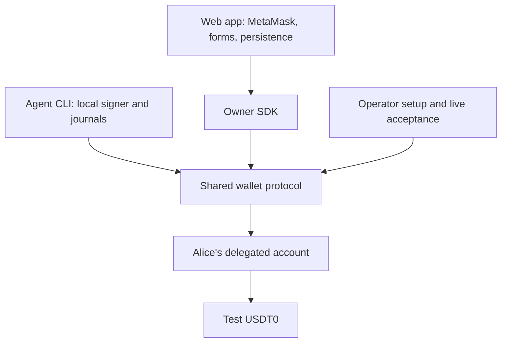

# Agent wallet CLI and owner SDK design

The CLI, owner SDK, web migration, contracts workspace, and tagged npm releases are implemented. This document replaces the original delivery plan with the design now in the repository. Use the [CLI reference](cli.md), [SDK reference](sdk.md), [operator guide](wallet.md), and [release guide](releases.md) for current commands and procedures.

## Roles and package boundaries

Alice owns an EIP-7702 account and authorizes bounded grants through her connected wallet. The agent uses a separate local key to pay one recipient under a grant's cumulative budget and deadline. Alice supplies payment funds; the agent supplies payment gas. Gas top-ups are separate owner transfers, outside grant budgets.

There is no AI model, decision loop, merchant delivery service, or hosted agent signer. External software can call the CLI and consume its JSON. Cloudflare serves the approval UI and public settings.

| Package | Responsibilities |
| --- | --- |
| [web](../packages/web) | React/Vite UI, MetaMask discovery, connection state, forms, and browser persistence. Imports owner operations through the SDK. |
| [cli](../packages/cli) | `agent-wallet` binary, explicit command dispatch, structured output, local signer, grant drafts, payment journals, and recovery. |
| [sdk](../packages/sdk) | Browser-compatible owner API and shared protocol. `viem` is a peer dependency; no React, Node filesystem, private-key store, or compiler dependency. |
| [contracts](../packages/contracts) | Solidity v3 implementation, Foundry configuration/tests, and migration fixtures. Private workspace with no SDK or UI dependency. |

The private root package orchestrates builds and checks. SDK and CLI are public npm packages under `@stablechain`; the web app and CLI depend on the exact SDK release version. Protocol code is compiled in the SDK rather than copied into its consumers.

## Code map

| Location | Responsibility |
| --- | --- |
| [CLI entry](../packages/cli/src/main.ts) | Command/flag validation, help, version, dispatch, and exit codes. |
| [CLI output](../packages/cli/src/output.ts) | One JSON envelope per command, public errors, and human payment summaries. |
| [Agent context](../packages/cli/src/agent/context.ts) | State selection, configuration verification, public identity, and lazy signer access. |
| [State store](../packages/cli/src/agent/state.ts) | Private regular files, mutation lock, atomic durable writes, and symlink/permission rejection. |
| [Agent grants](../packages/cli/src/agent/grants.ts) | Persistent approval drafts, links, and exact authorization waits. |
| [Agent payments](../packages/cli/src/agent/payments.ts) | Intent preparation, preflight, durable signing, receipt checks, unresolved-nonce blocking, and recovery. |
| [Owner SDK](../packages/sdk/src/index.ts) | Prepared owner operations, wallet submission boundary, persistence hook, funding, and confirmation. |
| [Protocol entry](../packages/sdk/src/protocol.ts) and [client modules](../packages/sdk/src/client) | ABI, amounts, configuration, identity verification, grant pages/statuses, gas estimates, receipt checks, and errors. |
| [Contract](../packages/contracts/src/AgentWallet.sol) | Onchain spending rules, owner forwarders, payment ID accounting, and isolated storage layout. |
| [Operator scripts](../scripts) | Activation/upgrades, compatibility adapters, live acceptance, and release tooling. |

The CLI exports Node-only services through `@stablechain/agent-wallet-cli/agent` for the compatibility scripts. SDK consumers import its public package exports, not files in another workspace's source tree.

## Agent payment guarantees

The executable accepts a stable payment ID and immutable grant, recipient, and amount. `payments prepare` saves an unsigned intent; `pay` checks the current account, policy, payment-ID marker, funds, gas, and exact simulation before signing. Dry-run performs checks without writing or signing.

The normal submission path is:

1. Lock the selected state directory and save the intent.
2. Reconcile other signed payments for this signer before signing a new nonce.
3. Prepare and sign once, then save signed bytes, hash, nonce, and context durably before broadcast.
4. Verify current network/account pins and broadcast the saved bytes.
5. Confirm only a receipt with the exact `Payment` event, then save its outcome.

`payments show` and `payments wait` never broadcast. `payments resume` checks receipts before current grant payability, so an already-successful payment can be recovered after expiry or exhaustion. If submission is still required, it reuses existing signed bytes or signs an unsigned intent once. A timeout remains unknown; it does not create a new payment attempt. The CLI offers no automatic fee bump, cancellation, or replacement intent.

Successful payment IDs are unique across Alice's account. A consumed ID without matching evidence blocks signing rather than proving the original terms. Included reverts roll back transfers, spending, and ID consumption but may cost gas. The contract enforces the rules again at execution; simulations and reserve estimates are observations.

## Owner submission boundary

The SDK separates preparation, `send`, and `wait`. Preparation works without a signing wallet. `send` reconstructs permitted calldata from normalized intent, rechecks the owner and chain, and persists the descriptor before asking the connected wallet to submit. Owner grant administration uses the implementation's `*For` forwarders; funding goes directly to the grant's agent.

The wallet returns a hash rather than its raw signed bytes. The SDK therefore observes persisted operations and verifies exact action receipts; it cannot promise the CLI's identical-byte rebroadcast recovery. Unknown wallet outcomes without a hash require reconciliation with wallet history. Persistence failure after a returned hash exposes that hash through `OwnerOperationError.operation`.

A client instance serializes submission requests and guards attempted operation IDs. Applications own persistence and unresolved-operation gates across reloads or client instances. The web app retains draft IDs, submitted hashes, and a funding guard, including recovery of an unknown funding transfer's hash.

Owner SDK reads return typed values including `bigint`; persisted `OwnerOperation` descriptors use JSON-safe strings. CLI JSON also serializes atomic values as decimal strings. Payment budgets have six decimal places; native gas balances have eighteen. Alice's native and ERC-20 balances represent the same underlying funds.

## State and compatibility

The CLI selects `--state-dir`, then `WALLET_STATE_DIR`, then `.agent-wallet` in the caller's current working directory. Operator/compatibility scripts retain repository-root path resolution. Each signer uses one shared persistent state directory; independent processes with separate copies of its key do not coordinate nonces.

State files include `agent-key.json`, `config.json`, `grant-draft-ID.json`, `payment-ID.json`, and `command.lock`. Operator deployment/activation journals remain alongside them. Keys are plaintext, with mode 700 directories and mode 600 files. Read-only diagnostics retain stale locks for explicit inspection.

Legacy payment journals remain readable. Loading signed records decodes their transaction and validates chain, recovered signer, destination, calldata, value, nonce, and hash against the saved intent. Recovery preserves signed bytes. Initialization retains an existing signer and refuses inconsistent key/address records.

Activation and v1/v2-to-v3 upgrades remain operator tasks in `wallet:enable`. The SDK verifies setup and reports errors; the CLI never reads Alice's environment file. Public configuration is allowlisted separately from private state. New grants start Active; legacy Pending records retain owner approval/rejection support.

## Build, verification, and publication

The SDK and CLI use separate emitting TypeScript builds; the CLI has a shebang and package `bin` entry. The web app uses Vite. `npm run build:tools` builds SDK then CLI without Foundry. Operator deployment and integration tests obtain bytecode from the contracts workspace.

Current verification includes SDK/CLI unit tests, Anvil subprocess integration, permission/legacy-state checks, workspace import boundaries, outside-checkout packed consumers, release ordering/retry tests, Foundry policy/migration/fuzz tests, and browser tests through the SDK. The packed SDK consumer is type-checked and bundled for a browser without Node filesystem or React imports. See [checks](wallet.md#checks) for prerequisites.

Real testnet acceptance remains an explicit operator workflow: it sends successful payments and deliberately reverted transactions. Normal diagnostics and test commands do not run it against the configured live account.

Stable version tags on commits contained in `main` trigger checks and SDK-first publication through npm trusted publishing, followed by an anonymous installation check. Manual release workflow runs are dry runs; pushes to `main` separately deploy the web app. See [releases](releases.md) for version alignment, provenance, and partial-release recovery.

## Possible extensions

Encrypted or external signers, explicit profiles, indexed onchain payment history, coordinated concurrent signing, CLI confirmation-depth controls, and merchant invoice identifiers remain future work. MCP or AI integrations can form a separate layer over the CLI/services; they are not included in the current packages.
