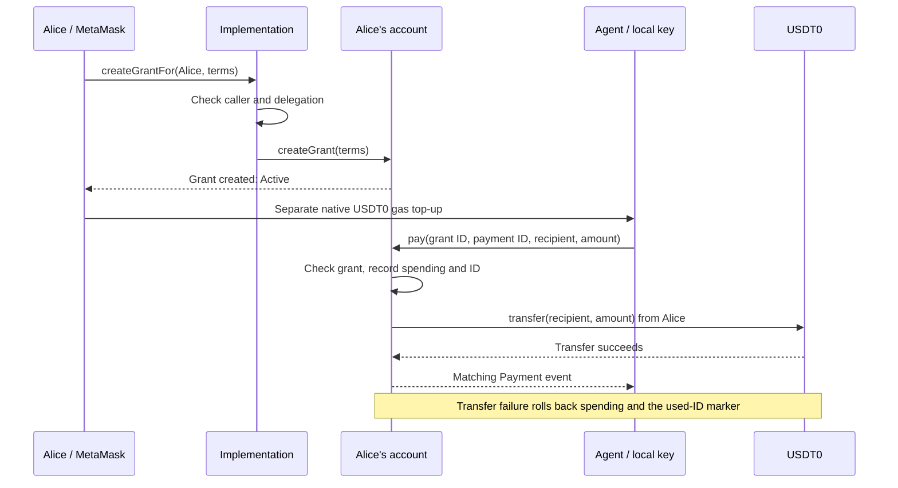
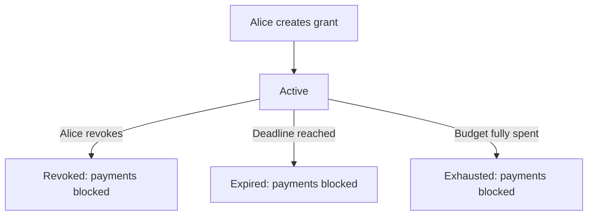

# Wallet guide

[Start with the overview](../README.md) for grants, gas, and the spending example. This guide covers operating the demo.

The [agent CLI](cli.md) provides structured commands for authorization links, permissions, payments, and recovery. The [owner SDK](sdk.md) exposes the wallet actions used by the browser app. Build both with `npm run build:tools`; the existing `wallet:*` aliases remain available.

## 1. Set up Alice and the agent

- Use Node.js 22+, [Foundry](https://getfoundry.sh/introduction/installation) 1.5.1 to match release CI, and Chrome MetaMask. Solidity is pinned to `0.8.30`.
- Choose a fresh test-only Alice account. Use the same address in MetaMask and the local setup script.
- Fund Alice with test USDT0 before enabling her account. Deployment and activation cost gas. See the [Stable faucet](https://faucet.stable.xyz).
- Run these commands from the repository root:

```sh
npm ci
umask 077
cp -n .env.alice.example .env.alice.local
chmod 600 .env.alice.local
```

- Set `ALICE_PRIVATE_KEY` in `.env.alice.local`: `0x` followed by 64 hexadecimal characters. Use a test-only key.
- Only `wallet:enable` reads this file. Never enter a private key in the web app.
- Existing `agent-wallet/.env.alice.local` files remain supported when the root key file is absent. `WALLET_ALICE_ENV` overrides the path.
- The example file also sets the testnet RPC and local approval-page URL.

```sh
npm run contracts
npm run wallet:enable
npm run wallet:init-agent
npm run dev
```

- `wallet:enable` deploys the implementation and authorizes it at Alice's existing address through EIP-7702. It verifies the installed code.
- `wallet:init-agent` generates a separate key and prints its address. Repeating it retains the existing key.
- Open [localhost:5174](http://localhost:5174) in Chrome. Connect Alice in MetaMask.

**Retain local state:** `.agent-wallet/` contains the agent's plaintext key, configuration, and transaction journals. File permissions restrict access: `700` for the directory, `600` for private files. This is not encrypted storage. Do not delete it to fix an error.

## Public wallet configuration

Setup saves private-directory state in `.agent-wallet/config.json` and publishes allowlisted public settings to `packages/web/public/wallet-config.json`. `wallet:init-agent` also updates its `defaultAgent`. Share the generated public file with a separate CLI installation or SDK consumer; importing it selects an account and verifies its setup, without authorizing a grant or sharing a signer key.

| Field | Meaning |
| --- | --- |
| `chainId` | `2201`, Stable Testnet. |
| `rpcUrl` | HTTPS RPC, or HTTP on `localhost`/`127.0.0.1` for local tests. The setup default is `https://rpc.testnet.stable.xyz`. |
| `token` | Test USDT0 at `0x78Cf24370174180738C5B8E352B6D14c83a6c9A9`. |
| `alice` | Owner's existing account address. |
| `implementation` | The verified deployed v3 implementation address. |
| `implementationCodeHash` | Keccak-256 hash of that implementation's deployed runtime bytecode, not a transaction hash. |
| `approvalUrl` | Base URL of the UI configured for this Alice account. Hosted builds require HTTPS. |
| `defaultAgent` | Optional public address used to prefill the UI. It does not provide that signer's key or select a standalone CLI's identity. |

The [configuration validator](../packages/sdk/src/client/config.ts) reconstructs this schema and discards additional fields. The CLI verifies chain/token identity, implementation pins, delegation, and version during import. Obtain configuration from the account operator; a bytecode hash supplied by an arbitrary source is not independent proof that its code is trustworthy.

Operator path overrides are relative to the repository root when not absolute:

| Variable | Use |
| --- | --- |
| `WALLET_STATE_DIR` | Operator/compatibility script state directory. The installed CLI instead resolves relative paths from its caller's working directory and also accepts `--state-dir`. |
| `WALLET_ALICE_ENV` | Alice's private environment file, read by `wallet:enable`. |
| `WALLET_PUBLIC_CONFIG_PATH` | Generated public development configuration destination. |

Production settings are a separate versioned file: [packages/web/deployment/wallet-config.json](../packages/web/deployment/wallet-config.json). Changing local setup does not change the hosted account. See [deployment](#deploy) before hosting another configuration.

## 2. Authorize a grant, then fund gas

Enter these terms in the app:

| Field | Example | Meaning |
| --- | --- | --- |
| Agent signer | Address from `wallet:init-agent` | Key allowed to submit payments |
| Allowed recipient | Your test recipient's address | Only destination for this grant |
| Cumulative budget | `0.01` USDT0 | Total allowed across successful payments |
| Expires | A future UTC time | Payments must execute before this deadline |

- Click **Create and authorize grant**. Review and confirm in MetaMask.
- One transaction creates an **Active** grant. Save its grant ID.
- Check **Agent gas** below the grant. If needed, review the amount and click **Fund agent gas**. Confirm this separate transfer in MetaMask.
- Alice pays both transaction fees. Gas funding belongs to the agent and does not reduce the grant's recorded budget.

The gas reserve estimates one payment, adds 50% extra gas, and uses twice the current base fee. The suggested top-up targets three payments. Costs can change; a failed check shows an unavailable status.

To prefill a grant without submitting a transaction:

```sh
expires=$(node -p 'new Date(Date.now() + 86400000).toISOString().replace(/\.\d{3}Z$/, "Z")')
npm run wallet:grant-link -- \
  --recipient 0xRECIPIENT_ADDRESS \
  --budget 0.01 \
  --expires "$expires"
```

Replace the recipient placeholder. The agent defaults to the initialized signer; `--agent 0xAGENT_ADDRESS` overrides it. Alice still reviews and authorizes the terms. `wallet:request` is retired.

## 3. Pay from the agent

From the repository root, prepare an explicit payment intent using the confirmed grant ID and its exact recipient:

```sh
npm --silent run wallet -- payments prepare \
  --grant 0xGRANT_ID \
  --recipient 0xRECIPIENT_ADDRESS \
  --amount 0.006 --json
# Save data.paymentId as PAYMENT_ID, then simulate and submit that same intent.
npm --silent run wallet -- pay --payment-id "$PAYMENT_ID" --dry-run --json
npm --silent run wallet -- pay --payment-id "$PAYMENT_ID" --json
```

- Replace the ID/address placeholders with full values. Preparation saves the ID and immutable terms before signing. Dry-run checks and simulates without changing state.
- Submission signs locally with the agent's key and saves the exact signed bytes before broadcast.
- The agent pays gas. Alice supplies the `0.006` payment.
- Under a `0.01` grant, another `0.006` is blocked. A new `0.004` payment can use the remainder.
- Amounts accept at most six decimal places. Extra digits are rejected, not rounded.

With the published executable, use the same commands starting with `agent-wallet`. Keep its selected state directory unchanged. The older `npm run wallet:pay -- --grant ID --recipient ADDRESS --amount AMOUNT` adapter remains available; it generates and prints an ID when omitted, so retain that ID for recovery.

Stable exposes USDT0 as a native gas balance with 18 decimals and an ERC-20 balance with six decimals. These represent the same underlying funds. Do not add them together.

## 4. Recover without paying twice

A timeout means the outcome is unknown. It does not prove failure.

- Check the transaction hash and inspect the same saved payment ID:

```sh
npm --silent run wallet -- payments show "$PAYMENT_ID" --json
npm --silent run wallet -- payments wait "$PAYMENT_ID" --timeout 120s --json
# If recovery needs submission, reuse the saved intent and exact signed bytes.
npm --silent run wallet -- payments resume "$PAYMENT_ID" --json
```

- `show` and `wait` never broadcast. `resume` checks for a receipt before submitting anything.
- If using the compatibility adapter, retry with its printed ID and identical terms:

```sh
npm run wallet:pay -- \
  --grant 0xGRANT_ID \
  --recipient 0xRECIPIENT_ADDRESS \
  --amount 0.006 \
  --payment-id 0xSAVED_PAYMENT_ID
```

- The journal retains the intent, signed transaction, hash, and nonce before broadcast. Retries reuse signed bytes or report the existing confirmation.
- Omitting `--payment-id` creates a new intent. Do not do that to recover an unknown payment.
- A successful receipt must contain the matching `Payment` event. A cancellation or replacement with a different action is not confirmation.
- Rejection before submission costs no gas. An included revert can cost gas, but rolls back the payment, spending, and used-ID marker.

The UI also retains submitted grant and gas-funding hashes across reloads. Unverified funding blocks another top-up until **Check funding confirmation** verifies the saved transaction. If the wallet failed to return a hash, find the transfer in MetaMask and use **Verify funding transaction** with that hash. Do not clear browser storage or send another top-up to recover an unknown outcome.

## How transactions reach Alice's account

The **implementation** supplies Alice's wallet code. EIP-7702 makes it execute with Alice's address, funds, and storage.

MetaMask can reject contract data sent from Alice to herself. Grant administration goes through the implementation instead. It checks that Alice sent the transaction and that her account delegates to this exact code, then forwards the action.



- Agent payments go directly to Alice's account. The agent cannot use the owner administration methods.
- Forwarding permits only grant creation, revocation, and legacy approval/rejection.
- A reentrancy guard blocks nested payments during a transfer.

## Grant states and limits



- Expiry and exhaustion are derived from the deadline and spending. They do not need a separate transaction.
- Pending and Rejected records remain for v1 compatibility. Alice can approve or reject an old Pending grant. New grants start Active.
- Payment checks require an Active grant, its exact signer and recipient, a positive amount, remaining budget, and time strictly before expiry.
- Successful payment IDs are unique across Alice's account, not just one grant. Grant terms cannot be edited or IDs reused.
- Alice can revoke a grant. Revocation takes effect when included onchain; it cannot undo an earlier payment.
- Alice retains owner authority. Revocation does not remove the persistent EIP-7702 delegation or recover gas funding.

## Upgrade an existing account

```sh
npm run wallet:enable -- --upgrade
```

- The script supports known v1/v2 deployments upgrading to v3. It refuses unrelated code or mismatched account/RPC configuration.
- Alice keeps her address. Compatible storage preserves grants, spending, and successful payment IDs.
- Retain the deployment journals and original build for recovery after interruption.
- The browser requires v3 and offers no activation or upgrade button.

## Checks

```sh
npx playwright install chromium
npm run check
npm run test:contracts
npm test
npm run test:browser
npm run build
```

- Foundry tests cover contract rules, rollback, forwarding, migration, and 256 generated budget cases.
- `npm run check` builds SDK/CLI declarations, type-checks code, and checks contract formatting. It requires Foundry.
- `npm test` builds contracts and tools, then runs SDK/CLI unit tests plus Anvil integration, workspace, release-helper, and packed-consumer checks. Integration tests use disposable keys and Anvil on port `18545`.
- The packed-consumer test uses npm's offline cache locally. With a fresh cache, use `CI=1 npm test` to permit dependency metadata downloads. It installs packed artifacts outside the checkout and checks a browser SDK consumer.
- Browser tests use a mock wallet and RPC. They do not prove a real MetaMask/testnet transaction succeeded.
- On Linux, `npx playwright install --with-deps chromium` also installs browser system dependencies. `WALLET_TEST_PORT` overrides browser tests' default port `5175`; local development/preview use `5174`.
- Use `WALLET_SOLC=/path/to/solc-0.8.30` if the compiler is installed separately. The `wallet:*` test/build aliases remain available; `wallet:request` exits with a retirement message because new grants are owner-created.

For real testnet receipts:

```sh
npm run wallet:live -- --phase prepare
```

- Open the printed links in Chrome. Create the expiring grant within five minutes, then the main and revocable grants. Revoke the latter. Fund the agent.
- Run `npm run wallet:live -- --phase exercise`. If it waits for expiry, repeat after the printed deadline.
- Run `npm run wallet:live -- --phase report` to refresh the evidence.
- The runner checks successful payments and blocked uncreated, revoked, expired, exhausted, wrong-signer, wrong-recipient, duplicate, and over-budget attempts.
- Negative attempts are deliberately included and reverted; they spend gas. Successful payments total `0.01` test USDT0. The agent also funds a test wrong-signer account with `0.01` for gas.
- `.agent-wallet/live-evidence.{json,md}` records hashes, receipt results, blocks, at least two confirmations, and fees. Receipt checks verify exact actions and events; observing MetaMask remains a separate check.

## Deploy

- **Public demo:** [agentic.stable.xyz](https://agentic.stable.xyz).
- **Worker:** `agentic-stable`; Cloudflare account `800c4ef344ae29a93b1588a10962b72c`.
- **Command:** `npm run deploy:cloudflare`, with access to that account and the `stable.xyz` zone.
- **GitHub Actions:** [deploy.yml](../.github/workflows/deploy.yml) uses Node 24 and builds/deploys pushes to `main`, or manual runs on `main`. Other branches cannot deploy. It requires a `CLOUDFLARE_API_TOKEN` repository secret.
- **Workers Builds:** root `/`; Node 22+; build `npm run build:cloudflare`; deploy `npx wrangler deploy`.

Use one automatic deployment path. Disable native Workers Builds when using GitHub Actions. The deployment token is separate from Alice's and the agent's signing keys. Keep it in GitHub Secrets, outside source files.

`npm run dev` reads generated local public settings. Production builds use [public deployment settings](../packages/web/deployment/wallet-config.json), which fixes the demo's Alice, implementation, and agent addresses. To host another setup, update those public settings from the verified local setup. Copy no keys or journals.

Every production build overwrites `dist/wallet-config.json` with those validated deployment settings; `npm run preview` therefore shows the production account, not the local development account. `npm run build:cloudflare` generates Worker types and builds the SDK/web app without Foundry. Cloudflare serves static assets; unmatched Worker requests return 404 and no hosted signing/payment API exists.

[wrangler.jsonc](../wrangler.jsonc) retains the custom-domain route. The unused `FundingLedger` export preserves an existing storage namespace; do not delete it or add a deletion migration during routine releases.

npm publication is separate from web deployment. Follow the [release guide](releases.md) to bump both public package versions and push a matching stable tag; ordinary commits to `main` do not publish npm packages.

## Scope

- Test-only, unaudited code. Mainnet is blocked by the contract and clients.
- No AI model, merchant delivery, gas sponsorship, or production custody.
- Start with the [contract](../packages/contracts/src/AgentWallet.sol), [SDK protocol](../packages/sdk/src/client/client.ts), and [payment script](../scripts/pay.ts) for implementation details.
- Protocol reference: [EIP-7702](https://eips.ethereum.org/EIPS/eip-7702). Network reference: [Stable docs](https://docs.stable.xyz).
